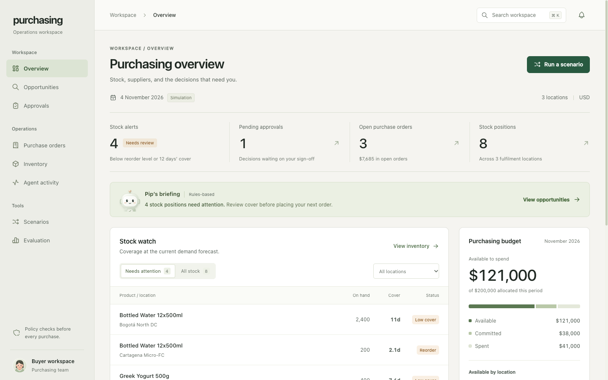
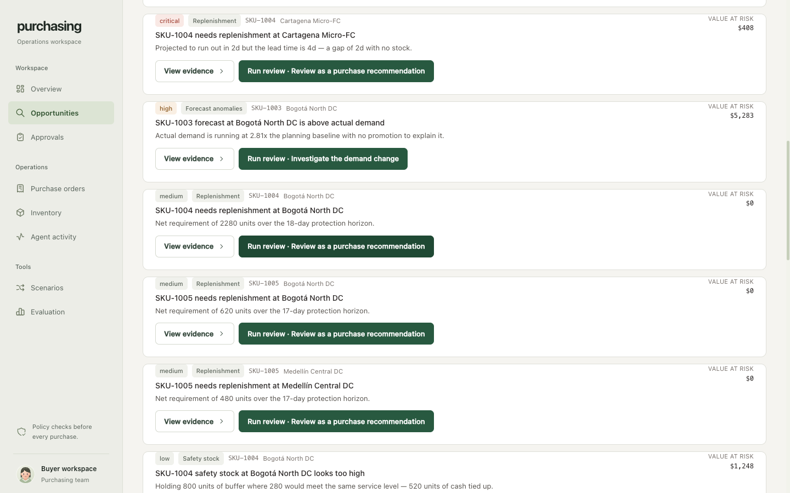
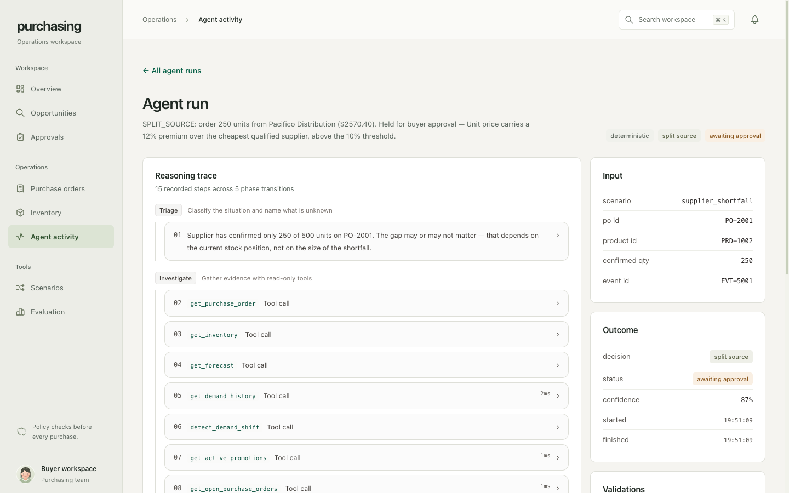

# Working demo

Two ways to see the system work. The first needs nothing but Node; the second shows the same
behaviour in the UI.

**No API key is required for either.** With no key configured the agent runs its deterministic
reasoning path, which exercises every part of the pipeline — tools, constraint engine, autonomy
gate, execution, post-execution validation, drift detection and self-correction.

---

## 1. Terminal demo — 30 seconds, zero configuration

```bash
npm install
npm run demo
```

This rebuilds the database from seed and runs six acts end to end, narrating each one. Nothing is
scripted — every number is computed from the data at run time.

| Act | What it demonstrates |
|---|---|
| 1 | **The recommendation is wrong.** 800 units recommended; the agent computes 350 and explains the gap. |
| 2 | **The recommendation is right.** A control case — the agent agrees and executes autonomously. |
| 3 | **A spike that is not a demand shift.** A promotion explains it, so the correct answer is to do nothing. |
| 4 | **A real shift, and a supplier that under-delivers.** Detect → approve → short-ship → drift → self-correct. |
| 5 | **A purchase that cannot execute as planned.** Storage binds before budget; the agent works around it. |
| 6 | **The opportunity sweep.** Everything above, found unprompted across the whole portfolio. |

It finishes by checking safety invariants against the database — no budget overdrawn, no storage
oversubscribed — and exits non-zero if any are violated.

### What to look for in Act 4

This is the part the assignment flags as most interesting. The sequence is:

1. The agent detects a genuine demand shift (2.81× baseline, sustained 7 days, z ≈ 35, no promotion).
2. It sizes a 1,500-unit expedited order worth $8,580.
3. $8,580 exceeds the $5,000 autonomy ceiling, so it **parks the action for approval** rather than
   executing.
4. The demo approves it.
5. The supplier **accepts the order and reports success — but silently confirms only 400 units.**
6. The agent re-reads the database (not the gateway's reply) and finds the discrepancy.
7. It classifies the drift as **material** — because re-running the requirement maths still shows a
   gap — and places a corrective 1,200-unit order with a *different* supplier.
8. It verifies that one too.

Steps 5–8 happen with no human prompting. Step 6 is the design decision that makes the rest
possible: a write tool returning success tells you the call succeeded, not that the outcome was
what you wanted.

---

## 2. Browser demo — about 90 seconds

```bash
npm run dev          # http://localhost:3000
```

### Scenario walkthrough

1. **Open `Scenarios`.** Each card states the situation and the tension in it.
2. **Run "Energy drink sales have tripled".** Watch the reasoning trace build. The agent decides
   `EXPEDITE 1,500` and stops — status `awaiting_approval`.
3. **Open `Approvals` and click "Approve & execute".** The supplier short-ships. The page reports
   `drift: material` and shows the corrective purchase order the agent raised on its own.
4. **Open the run from `Agent activity`.** All steps are grouped by phase — triage, investigate,
   decide, pre-validate, act, post-validate — with each tool's arguments and results inspectable.
5. **Open `Purchase orders`.** The partially-confirmed order is highlighted where confirmed quantity
   differs from ordered. That difference is exactly what the post-execution check looks for.

Then run **"Yogurt sales are up 60%"**. Statistically it is near-identical to the energy drink, but
a running promotion explains it, so the correct answer is to do nothing — and the agent does
nothing.

### Opportunity sweep

6. **Open `Opportunities`.** This is the proactive half: the same primitives applied to the whole
   portfolio rather than to one situation handed to the agent.

   Note that it **independently rediscovers the scenarios from raw data** — the 338-unit
   requirement behind Scenario 1, the unexplained demand change behind Scenario 3, the promotion
   that explains the one which looks identical, and the unactioned supplier message behind
   Scenario 2.

7. **Click "View evidence"** on any finding to see the working.
8. **Click "Run review"** on the Highland Coffee finding. The agent investigates, decides
   `SPLIT_SOURCE`, and holds it for approval because the alternate supplier carries a 12% premium.
   The finding then **disappears from the sweep** — the underlying condition is resolved — and the
   banner says so, with a link to the full trace.

### Evaluation

9. **Open `Evaluation` and run the suite.** 7 cases, 61 assertions, checked against the run result,
   the recorded trace, and the database state afterwards.

---

## Screenshots

**Dashboard** — stock cover, budget and space headroom, recent agent activity.



**Opportunities** — the portfolio sweep, after handing a finding to the agent. Note the banner:
decision `split source`, `finding cleared`, and a link to the trace.



**Reasoning trace** — one run, grouped by phase, every tool call inspectable.



---

## Things worth knowing before you run it

**Supplier faults are ON by default.** The first time you run the energy-drink scenario you will see
what looks like a failure — the supplier confirms 400 of 1,500. That is deliberate, and it is the
whole point: it is what the post-execution validation and self-correction exist to catch. Set
`FAULT_INJECTION=off` to see the happy path instead.

**"Today" is fixed** at `2026-11-04` (`SIM_TODAY`) so seeded demand history, forecast windows and
every evaluation assertion stay reproducible regardless of the real date.

**The database is rebuilt by `npm run dev`**, so the demo always starts from a known state. Use
`npm run db:reset` to reset it at any point, or the Reset control in the UI.

**To enable LLM reasoning**, copy `.env.example` to `.env.local` and add a key for any one provider.
Google Gemini and Groq both have free tiers. The deterministic engine still runs alongside it as a
guardrail — the model proposes, the policy and constraint engines dispose.
