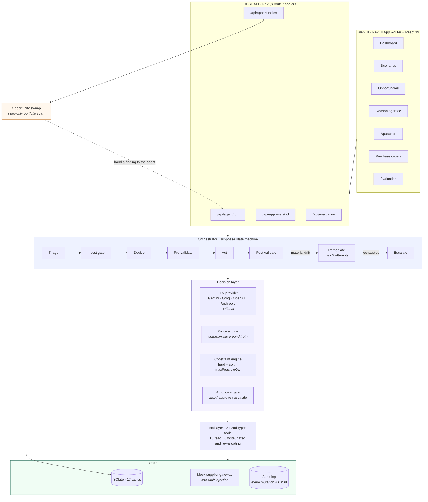
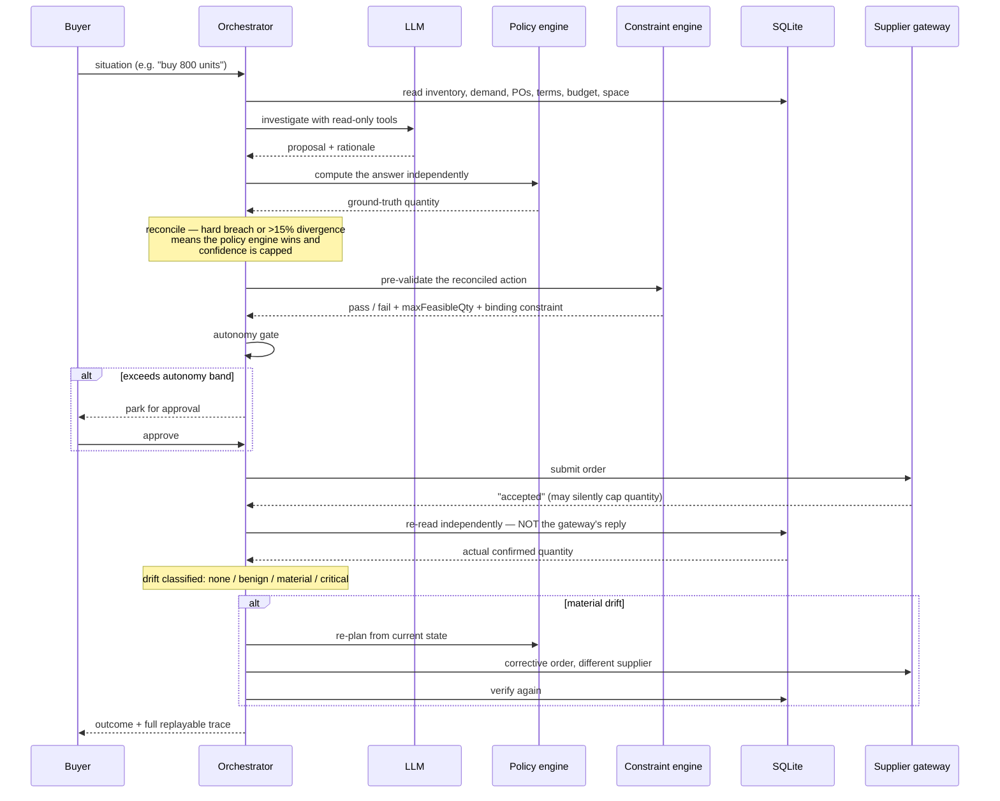

# AI Purchasing Agent

An agent that makes, executes and **validates** purchasing decisions for a quick-commerce retailer.

It is not a chatbot that answers questions about purchasing. It takes a situation, investigates it
with tools, decides what to do, checks that decision against hard business constraints *before*
writing anything, executes it, then re-reads the world to confirm what actually happened — and
corrects itself when the outcome differs from what it intended.

All four assignment scenarios are implemented end-to-end.

---

## Quick start

```bash
npm install
npm run dev          # rebuilds the demo database, then starts on http://localhost:3000
```

**No API key is needed.** With no key configured the agent runs in deterministic mode, which
exercises every part of the pipeline except the natural-language reasoning. To enable LLM
reasoning, copy `.env.example` to `.env.local` and add a key for any one provider — Google Gemini
and Groq both have free tiers.

```bash
npm run eval         # run the evaluation suite (7 cases, 61 assertions)
npm run db:reset     # rebuild the demo world from scratch
npm run typecheck    # strict TypeScript, no errors
```

```bash
npm run demo         # the whole system end to end in the terminal, ~30s, no browser
```

A full walkthrough of both the terminal and browser demos, with screenshots and what to look for at
each step, is in [`DEMO.md`](DEMO.md).

### The 90-second demo

1. Open **Scenarios**.
2. Run **"Energy drink sales have tripled"**.
   The agent detects a real demand shift, sizes a 1,500-unit expedited order, and stops — the value
   exceeds its $5,000 autonomy ceiling.
3. Click **Approve & execute**.
   The supplier silently confirms only **400 of 1,500 units**. The agent catches this by re-reading
   the database, classifies it as *material drift*, and places a corrective 1,200-unit order with a
   different supplier — unprompted.
4. Open the **reasoning trace** to see all 21 steps across six phases.

Then run **"Yogurt sales are up 60%"**. Statistically it looks identical to the energy drink, but a
running promotion explains the lift, so the correct answer is to do nothing. The agent does nothing.

---

## Architecture



**The decision path for a single run:**



A fuller write-up, including the data model and the reasoning behind each design choice, is in
[`docs/architecture.md`](docs/architecture.md).

---

## Approach

### The agent does not do arithmetic

Every number in a decision comes from a tool that runs real code against real data —
`compute_net_requirement`, `detect_demand_shift`, `shape_order_quantity`, `validate_purchase`.
The model chooses *which* questions to ask and explains the answer; it never calculates. That
removes an entire class of hallucinated figures and makes every number in the final rationale
reproducible and auditable.

### Two brains, and the deterministic one wins

A **policy engine** computes the correct answer directly from the data, with no model involved.
It serves three purposes at once:

1. **Fallback** — the whole system runs end-to-end with no API key.
2. **Guardrail** — the model proposes; the policy engine and constraint engine dispose. A proposal
   that breaches a hard constraint is overridden, never executed. A proposal that diverges more
   than 15% from what the data supports is overridden *and* has its confidence lowered, which
   routes it to a human.
3. **Oracle** — the evaluation harness asserts model behaviour against it.

This is the core reliability argument. The model's upside is judgement and explanation; its
downside is bounded by code that cannot be talked out of a constraint.

### Recommendations are claims, not instructions

Scenario 1 hands the agent a recommendation for 800 units. The agent recomputes requirement from
scratch:

```
protection horizon   = lead time 7d + review period 14d      = 21 days
demand over horizon  = 28/day × 21d                          = 588 units
requirement          = 588 + 180 safety stock                = 768 units
supply               = 320 on hand + 150 in transit − 40 reserved = 430 units
net requirement      = 768 − 430                             = 338 units
→ rounded up to the supplier's 50-unit lot                   = 350 units
```

The recommendation overstates requirement by 56%, largely because it ignores 150 units already in
transit. The agent modifies it to 350 — and because a 56% cut exceeds its autonomy band, it routes
the change to a buyer rather than applying it silently.

A control case (`S1-correct-recommendation`) hands it a recommendation that *is* right. The agent
accepts and executes it autonomously. An agent that always finds something wrong is as useless as
one that rubber-stamps.

### A spike is not automatically a demand shift

Before concluding demand has changed, four evidence gates must all pass:

| Gate | Test |
|---|---|
| Magnitude | trailing 7-day mean ≥ 1.5× the forecast baseline |
| Sustainment | ≥ 5 consecutive days above 1.2× baseline |
| Significance | z-score of the recent mean ≥ 2.0 vs the prior period |
| Attribution | not explained by an active promotion |

The energy drink clears all four (2.8×, 7 days, z≈30, no promo) → re-plan.
The yogurt clears the first three but fails the fourth — a 2-for-1 promotion with a +60% expected
uplift explains the observed +61% — → do nothing, and explicitly **refuse** to rebase the forecast.
`update_forecast_baseline` enforces this at the tool boundary: it rejects any rebase attempt on
promotion-driven demand even if the orchestrator asks for one.

### Constraints are the interesting part

Hard constraints block execution: budget, storage capacity, supplier MOQ, lot size, per-order caps,
supplier active, supplier carries the product. Soft constraints do not block but lower confidence
and force human review: overstock, shelf life, supplier reliability, lead time vs projected stockout.

Every failed hard check reports `maxFeasibleQty` — the largest quantity that *would* pass. That is
what lets the agent answer a blocked purchase with a workable counter-proposal instead of giving up.

In Scenario 4, Cartagena needs 1,700 units of bottled water. Storage binds first (3 slots per unit,
1,000 units of room) before budget does. The agent orders the largest lot-aligned quantity that
fits, names the binding constraint, and proposes redirecting the 700-unit balance to a node with
spare capacity.

### When human approval is appropriate

Thresholds live in the `agent_policies` table, not in code, so a buyer can tune the agent's leash
without a deploy:

| Policy | Default | Why |
|---|---|---|
| `max_auto_order_value` | $5,000 | Caps blast radius of any single mistake |
| `max_auto_qty_deviation_pct` | 25% | Large departures from the recommendation need a human |
| `max_auto_price_premium_pct` | 10% | Paying materially over the cheapest source is a commercial call |
| `min_auto_confidence` | 0.70 | Thin or conflicting evidence routes to a person |
| `max_remediation_attempts` | 2 | Bounded self-correction; then escalate rather than thrash |

Any soft-constraint warning, or sourcing from a non-preferred supplier, also forces approval.

Approving is not a rubber stamp in this system: it resumes the parked action, executes it, verifies
the result against the agent's original expectation, and self-corrects if the supplier does
something unexpected.

---

## The feedback loop

This is the part the assignment flags as most interesting, so it is worth being precise about.

**Before acting**, the agent writes an explicit, checkable **expectation contract**:

> Creating a purchase order with SUP-03 for 1,500 units of PRD-1003 at NODE-BOG-01. Expect: order
> confirmed in full, total cost at most $8,751.60, inbound stock up by 1,500, projected cover of
> ~22 days, budget not overdrawn.

**After acting**, it re-reads the world **from the database, not from the write tool's return
value**, and checks every field.

That distinction is the whole point. A write tool reporting success tells you the call succeeded,
not that the outcome was what you wanted. In this system `SUP-03` confirms only 400 units against
any order larger than that, and says so politely in a message field. The only way to find out is to
look.

Drift is then classified, and the classification decides what happens next:

| Severity | Meaning | Response |
|---|---|---|
| `none` | Outcome matched on every dimension | Done |
| `benign` | Differs, but the objective still holds — e.g. a shortfall that leaves no outstanding requirement | Record and continue |
| `material` | Objective not met — e.g. a real gap remains | Self-correct, up to 2 attempts |
| `critical` | Invariant broken — PO missing, budget overdrawn, storage oversubscribed | Stop and escalate; no further writes |

Severity is derived, not assumed. A 1,100-unit shortfall is only *material* if re-running the
requirement maths against the actual stock position still shows a gap. If stock turns out to be
adequate anyway, the same shortfall is *benign* and the agent correctly does nothing further.

Remediation re-plans from current state rather than trusting the reported shortfall, and prefers a
*different* supplier — the one that just under-delivered has demonstrated it cannot serve the
volume. Attempts are bounded; exhausting them escalates with full context rather than retrying
indefinitely.

**Safety invariants** are asserted after every evaluation case, not just the ones that test drift:
no node budget may go negative, and no node storage may be oversubscribed. These hold across all
seven cases.

---

## Evaluation

```bash
npm run eval          # deterministic — no API key required
npm run eval:llm      # with LLM reasoning, if a key is configured
```

Also runnable from the **Evaluation** page in the UI.

Each case runs against a **freshly rebuilt database**, so cases are independent and reproducible.
Assertions are checked against three sources:

- the **run result** — what the agent decided;
- the **recorded trace** — which tools it actually called, and whether it validated;
- the **database** — what the world looks like afterwards.

The third matters most. An agent can claim anything; the honest test is the state of the world.

The assignment's six evaluation questions map to concrete assertions:

| Question | Assertions |
|---|---|
| Was the decision correct? | `decision`, `quantity`, `supplier` |
| Did it obtain the necessary information? | `evidence gathered` — required tools appear in the trace |
| Did it respect relevant constraints? | `constraints respected`, `soft warnings surfaced` |
| Did it take the appropriate action? | `autonomy routing`, `final status` |
| Did it validate the result? | `pre-flight validation`, `post-execution validation` |
| What happens when the action fails? | `drift classification`, `self-correction` |

### Cases

| # | Case | What it protects |
|---|---|---|
| 1 | `S1-over-recommendation` | Catches a 56% over-recommendation; routes a large change to a human |
| 2 | `S1-correct-recommendation` | Agrees when the recommendation is right, and executes autonomously |
| 3 | `S2-supplier-shortfall` | Re-sources a gap from a dearer, less reliable alternate — and flags both facts |
| 4 | `S3-real-demand-shift` | Full loop: detect → approve → supplier short-ships → drift → self-correct |
| 5 | `S3-promo-explained-spike` | Negative control: refuses to over-buy into a promotion |
| 6 | `S4-storage-constrained` | Identifies the binding constraint and works around it |
| 7 | `S4-infeasible-escalates` | Never emits an order that breaches a hard constraint |

Current result: **7/7 cases, 61/61 assertions.**

Cases 2 and 5 are deliberately negative controls. Without them, an agent that always found a
problem and always bought something would score perfectly — which would tell you nothing.

---

## Scenario coverage

| Scenario | Status | Outcome |
|---|---|---|
| **1 — Recommendation review** | Complete | MODIFY 800 → 350; separate case ACCEPTs a correct recommendation |
| **2 — Supplier cannot fulfil** | Complete | SPLIT_SOURCE: amend to 250, expedite 250 from an alternate, flag the 12% premium |
| **3 — Demand changed** | Complete | EXPEDITE 1,500 + full drift/remediation loop; promo case correctly NO_ACTION |
| **4 — Purchasing constraint** | Complete | MODIFY to the storage-feasible 1,000, redirect the balance to another node |

---

## Beyond the four scenarios — the opportunity sweep

The four scenarios are all **reactive**: something lands on the buyer's desk and the agent responds.
The larger part of a real buyer's day is noticing the things nobody flagged.

`src/lib/domain/opportunities.ts` sweeps the whole portfolio and surfaces six classes of problem —
covering most of the optional list in the brief:

| Finding | What it catches | Assignment topic |
|---|---|---|
| **Replenishment** | Lines with a net requirement nobody has raised an order for, ranked by whether stock runs out before a replenishment could land | replenishment |
| **Open purchase orders** | Unactioned supplier messages, confirmed-short lines, and overdue deliveries still counted as inbound cover | open purchase orders |
| **Supplier reliability** | Realised fill rate computed from the order book, compared against the score planning actually uses | supplier reliability |
| **Forecast anomalies** | Baselines that have drifted from reality — in both directions — separating promotion-explained lift from genuine change | forecast anomalies, promotional buying |
| **Safety stock** | Buffers set from a round number, re-derived from demand and lead-time variability at a ~95% service level | safety stock |
| **Overstock & spoilage** | Cover beyond the policy threshold, and quantities that will expire before they sell | seasonal / excess stock |

Three properties make this more than a second dashboard:

**It reuses the agent's own primitives.** `computeNetRequirement`, `detectDemandShift`,
`spoilageRisk`, `listSupplierOptions` — the same functions, so a finding is computed exactly the way
the agent would compute it. The visible consequence is that the sweep **independently rediscovers
the assignment scenarios from raw data**: the 338-unit requirement behind Scenario 1, the
unexplained demand change behind Scenario 3, the promotion that explains the one which looks
identical, and the unactioned supplier message behind Scenario 2. None of them are hand-fed.

**It hands findings back to the agent.** Each finding carries an agent-ready payload, so "Run
review" on the Opportunities page sends it through the full pipeline — investigation, constraint
checks, autonomy gate, execution, post-execution validation. Detection feeds decision.

**It is strictly read-only.** Detection and action are kept apart deliberately. A sweep that quietly
placed orders across the whole catalogue is precisely the unbounded autonomy the rest of the system
exists to prevent.

It also surfaces something the static seed cannot: **supplier reliability findings only appear after
the agent has acted.** Once SUP-03 short-ships against a live order, its realised fill rate (48%)
diverges from the score planning uses (79%), and the sweep flags it. The system's view of its
suppliers is updated by its own experience.

---

## Mock services and data

Everything needed to run the application is in the repository. There are no external dependencies
and no accounts to create.

| Component | What it is | Where |
|---|---|---|
| **Database** | SQLite, 17 tables, created on demand. No server to install. | `src/lib/db/schema.sql` |
| **Dataset** | 3 fulfilment nodes, 5 products, 7 suppliers, 35 days of demand history, 3 open POs, 1 live supplier event, 1 active promotion, budgets and storage limits | `src/lib/db/seed.ts` |
| **Supplier gateway** | Mock external system the agent submits orders to. Deliberately imperfect — SUP-03 silently caps any order at 400 units, SUP-05 refuses expedites it cannot service. | `src/lib/mock/supplier-gateway.ts` |
| **Supplier inbox** | Inbound events (partial fulfilment, delay, cancellation). New ones can be injected at `POST /api/supplier-events` to create fresh situations. | `src/app/api/supplier-events/route.ts` |
| **LLM providers** | Optional. Gemini, Groq, OpenAI, Anthropic over plain `fetch`. With no key the deterministic engine runs the whole pipeline. | `src/lib/agent/llm.ts` |

Demand history is generated from a seeded PRNG, so every number — and therefore every assertion —
is identical on every machine.

The seed is tuned so that **the obvious answer is wrong in each scenario**. That is the point: an
agent evaluated against data where the naive answer happens to be correct tells you nothing.

---

## Tools

21 tools, each with a Zod schema that is validated on every call and converted to JSON Schema for
LLM function calling.

**Read (15)** — `get_inventory`, `get_demand_history`, `get_forecast`, `get_open_purchase_orders`,
`get_purchase_order`, `list_supplier_options`, `get_budget`, `get_storage_capacity`,
`get_active_promotions`, `compute_net_requirement`, `detect_demand_shift`, `shape_order_quantity`,
`validate_purchase`, `check_supplier_availability`, `find_node_with_capacity`

**Write (6)** — `create_purchase_order`, `amend_purchase_order`, `cancel_purchase_order`,
`update_forecast_baseline`, `request_human_approval`, `escalate_to_buyer`

The model only ever gets the read tools. Writes are performed by the orchestrator after the
autonomy gate, and each write tool independently re-validates against the constraint engine at its
own boundary — so a write that would breach a hard constraint is refused even if every layer above
it was wrong.

---

## Data model

17 tables in SQLite. The ones that carry the interesting logic:

- `supplier_products` — MOQ, lot size, per-order cap, expedite terms. Where hard constraints live.
- `inventory` — on hand / reserved / in transit / safety stock, separated so "available to promise"
  is computable rather than guessed.
- `promotions` — what makes a demand spike explicable.
- `agent_policies` — autonomy thresholds, tunable without a deploy.
- `agent_runs` + `agent_steps` — the full replayable trace.
- `validations` — pre- and post-execution constraint results.
- `audit_log` — every mutation, with before/after state and the run that caused it.

Seed data is deliberately tuned so the obvious answer is wrong in each scenario. Demand history is
generated from a seeded PRNG, so every number — and therefore every assertion — is stable.

---

## Project layout

```
src/
  lib/
    db/          schema.sql · client · repo · seed
    domain/      types · math · constraints · policy · autonomy
    agent/       orchestrator · tools · feedback · llm · prompt
    mock/        supplier-gateway (with fault injection)
  app/           pages + API routes
  components/    shared UI
eval/            cases · runner
scripts/         reset-db · run-eval
docs/            architecture.md
```

---

## Technology

Next.js 16 (App Router) · React 19 · TypeScript (strict) · SQLite via better-sqlite3 · Zod ·
Tailwind CSS. LLM access is written against plain `fetch` rather than four vendor SDKs, which keeps
the dependency surface small and the request shapes visible.

---

## Known limitations

Worth stating plainly, since this was a one-day build:

- **Single-process concurrency.** SQLite in WAL mode with no row locking. Two agents running
  simultaneously against the same node's budget could race. A real deployment would need
  transactional reservation of budget and storage.
- **Safety stock is a fixed figure in the planning path.** The opportunity sweep *derives* it from
  demand and lead-time variability at a ~95% service level and flags lines that are mis-set, but
  the replenishment maths still uses the stored per-line number. Closing that loop — having the
  agent act on its own safety-stock findings — is the obvious next step.
- **Promotion attribution is a single heuristic.** It compares observed uplift against the
  promotion's expected uplift with a 1.25× tolerance. Real attribution would need a counterfactual
  baseline.
- **Remediation prefers a different supplier unconditionally.** Sometimes the right move is to
  re-order from the same supplier next cycle rather than pay a premium elsewhere.
- **The LLM path is the thinner one.** Most of the engineering is in the deterministic engine and
  the feedback loop, which is where I think the real value sits — but it does mean the model's
  contribution is mostly narrative and investigation sequencing rather than decision-making.

---

## Where each submission requirement lives

| Requirement | Where |
|---|---|
| Complete source code | this repository — `src/`, `eval/`, `scripts/` |
| Setup and run instructions | [Quick start](#quick-start), above |
| Architecture diagram | [Architecture](#architecture) — three Mermaid diagrams, rendered inline by GitHub |
| Description of the approach | [Approach](#approach) and [`docs/architecture.md`](docs/architecture.md) |
| Test scenarios and evaluation approach | [Evaluation](#evaluation), `eval/cases.ts`, `npm run eval` |
| Mock APIs, datasets, supporting services | [Mock services and data](#mock-services-and-data) — all in-repo, nothing external |
| How agent decisions are validated | [The feedback loop](#the-feedback-loop) — pre-validation, expectation contracts, independent re-read, drift classification |
| Working demo | [`DEMO.md`](DEMO.md) — `npm run demo` for the terminal, `npm run dev` for the UI, with screenshots |
| `.env.example` | [`.env.example`](.env.example) — every variable documented, none required |
| No secrets committed | no keys in the tree or in history; `.env*` is gitignored |
| Additional buyer problems (optional) | [Beyond the four scenarios](#beyond-the-four-scenarios--the-opportunity-sweep) — six finding classes covering replenishment, open POs, supplier reliability, forecast anomalies, promotional buying and safety stock |
