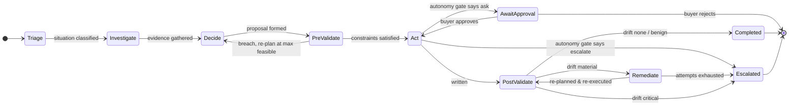

# Architecture

Design notes for the AI Purchasing Agent: what the pieces are, why they are split that way, and
which trade-offs were deliberate.

---

## 1. The shape of the problem

A buyer deciding what to purchase is doing four separable things:

1. **Establishing facts** — what do we hold, what is already coming, what is selling.
2. **Computing a requirement** — arithmetic over those facts.
3. **Fitting it to reality** — MOQ, lot sizes, budget, storage, supplier capacity.
4. **Deciding whether to act alone** — or ask someone.

Most of the difficulty is not in step 2. It is that step 1 is incomplete, step 3 is where good
plans die, and step 4 is a judgement call with real consequences. An agent that is good at step 2
and naive about the rest is worse than no agent, because it produces confident, wrong orders.

So the system separates them explicitly, and puts the deterministic parts in code.

---

## 2. Six-phase orchestration

The orchestrator (`src/lib/agent/orchestrator.ts`) is a state machine, not a chat loop.



| Phase | Responsibility |
|---|---|
| **Triage** | Classify the situation; state explicitly what is unknown |
| **Investigate** | Gather evidence with read-only tools |
| **Decide** | Form a decision — LLM proposes, policy engine cross-checks |
| **Pre-validate** | Push the decision through the constraint engine *before* writing |
| **Act** | Execute, request approval, or escalate — per the autonomy policy |
| **Post-validate** | Re-read the world, compare against the expectation contract |
| **Remediate** | Self-correct material drift, bounded attempts |
| **Escalate** | Hand to a human with full context |

Phases are explicit because the interesting failures happen *between* them: a decision that looked
right but cannot execute (caught at pre-validate), or an action that executed but did not achieve
what it claimed (caught at post-validate). A single-loop agent conflates these and loses the
distinction.

Every phase transition is written to `agent_steps`, so a run is fully replayable.

---

## 3. Dual-brain: LLM proposes, deterministic engine disposes

Two independent decision paths run over the same data.

**The policy engine** (`src/lib/domain/policy.ts`) computes the correct answer directly from the
database. No model. One function per scenario:

- `reviewRecommendation` — Scenario 1
- `resolveShortfall` — Scenario 2
- `assessDemandShift` — Scenario 3
- `planConstrainedPurchase` — Scenario 4

**The LLM path** investigates with read-only tools and commits via a `submit_decision` call.

### Reconciliation

| Condition | Outcome |
|---|---|
| Model's proposal breaches a hard constraint | Overridden with the policy engine's constraint-legal quantity |
| Model's quantity diverges > 15% from the policy engine | Policy quantity used; confidence lowered to ≤ 0.65, which trips the autonomy gate and routes to a human |
| Agreement within 15% | Policy engine's arithmetic kept, model's narrative and key factors adopted |

The divergence is written to the trace either way, so disagreements are visible rather than
silently resolved.

This is the reliability argument. The model contributes judgement about *which* questions matter
and a readable explanation. It cannot contribute an illegal order, because the number that
executes always came from code.

It also means the system degrades gracefully: with no API key, the LLM path is simply absent and
everything else runs unchanged.

---

## 4. The constraint engine

`src/lib/domain/constraints.ts`. Every proposed purchase passes through `validatePurchase()`.

**Hard** (blocks execution):

| Code | Check |
|---|---|
| `SUPPLIER_CATALOGUE` | Supplier actually lists this product |
| `SUPPLIER_ACTIVE` | Supplier is not suspended |
| `MOQ` | Meets minimum order quantity |
| `LOT_SIZE` | Quantity is a clean multiple of the lot size |
| `SUPPLIER_CAP` | Within the per-order maximum |
| `BUDGET` | Fits the node's remaining budget this period |
| `STORAGE` | Fits the node's free storage slots |

**Soft** (lowers confidence, forces approval, does not block):

| Code | Check |
|---|---|
| `OVERSTOCK` | Resulting cover exceeds 45 days |
| `SPOILAGE` | Sell-through time exceeds shelf life |
| `RELIABILITY` | Supplier fill rate below 85% |
| `LEAD_TIME` | Delivery lands after the projected stockout |

### `maxFeasibleQty` — the design decision that matters

Each failed hard check reports the largest quantity that *would* pass, and the engine computes the
minimum across all caps, re-aligned to the supplier's lot size. It also names the `bindingConstraint`.

Without this, a blocked purchase can only produce "cannot execute". With it, the agent can answer
"1,700 is impossible; 1,000 is the most that fits, limited by storage; here is where the other 700
should go." That is the difference between Scenario 4 being a failure case and a solved one.

### Validation runs twice

- `validatePurchase()` — before writing. Can this legally execute? What is the maximum that can?
- `validateResultingPo()` — after writing. Does the resulting world still satisfy everything?

Both are persisted to the `validations` table.

---

## 5. The feedback loop

`src/lib/agent/feedback.ts`.

### Expectation contracts

Before acting, the agent writes down a structured, checkable claim about the post-action world:
which PO should exist, what quantity should be confirmed, what status, a cost ceiling, minimum
inbound stock, minimum projected cover.

### Independent verification

After acting, `verifyExpectation()` re-reads from the database. It deliberately does **not** use
the write tool's return value.

This matters because the two can disagree. `create_purchase_order` returns `{ ok: true }` when the
supplier accepts *something*. In this system `SUP-03` accepts 400 units against a 1,500-unit order
and returns a polite message about allocation limits. A system that trusts its own write path
believes it ordered 1,500.

### Drift classification

| Severity | Meaning | Response |
|---|---|---|
| `none` | Matched on every dimension | Done |
| `benign` | Differs, objective still holds | Record, continue |
| `material` | Objective not met | Self-correct, bounded |
| `critical` | Invariant broken | Halt, escalate, no further writes |

Severity is **derived, not assumed**. A shortfall is only material if re-running the requirement
maths against actual current stock still shows a gap. The same 1,100-unit shortfall would be
classified `benign` if stock turned out to be adequate — and the agent would correctly stop.

Budget overdraft and storage oversubscription are always `critical`. They represent broken
invariants, not bad outcomes, so the response is to stop rather than to compensate.

### Remediation

`planRemediation()` re-derives the gap from current state rather than trusting the reported
shortfall, then ranks alternates by: can it arrive before the projected stockout → price →
reliability. It excludes the supplier that just under-delivered.

Attempts are capped by `max_remediation_attempts` (default 2). Exhausting them escalates with the
full list of what was tried. The agent does not thrash.

---

## 6. Autonomy and human-in-the-loop

`src/lib/domain/autonomy.ts`. Thresholds are rows in `agent_policies`, not constants, so a buyer
can tune the leash without a deploy.

```
escalate   if  hard constraints remain unsatisfiable
approve    if  value > $5,000
             | |qty deviation| > 25% from the recommendation
             | price premium > 10% over the cheapest qualified supplier
             | supplier is not the preferred source for this product
             | confidence < 0.70
             | any soft constraint warning
auto       otherwise
```

Approval is not cosmetic. `resumeApprovedAction()` executes the parked action, runs the full
post-validation and drift pipeline against it, and self-corrects if needed. Approving a
1,500-unit order in this system is what triggers the supplier cap, the drift detection, and the
corrective order — the human unblocks the agent, they do not take over from it.

### Confidence

Confidence measures how much the decision should be trusted, not how good it is:

```
start 0.95
  − 0.08 per soft warning
  − 0.25 per hard failure
  − 0.10 if < 21 days of demand history
  − 0.15 further if < 14 days
  − 0.10 if coefficient of variation > 0.5
  − 0.10 further if > 0.8
```

Low confidence is a *correct* output when evidence is thin — it routes the decision to a person,
which is the right behaviour.

---

## 7. Demand-shift detection

`detectDemandShift()` in `src/lib/domain/math.ts`. Four gates, all must pass:

| Gate | Test | Guards against |
|---|---|---|
| Magnitude | 7-day mean ≥ 1.5× baseline | Noise |
| Sustainment | ≥ 5 consecutive days above 1.2× | A one-day spike |
| Significance | z ≥ 2.0 vs the prior period | Naturally volatile SKUs |
| Attribution | not explained by a promotion | Buying into a temporary lift |

The fourth gate is the one that separates reasoning about cause from pattern-matching on a number
going up. A promotion "explains" a spike when observed uplift ≤ 1.25 × the promotion's expected
uplift.

**Seeded comparison:**

| | Energy drink (PRD-1003) | Yogurt (PRD-1005) |
|---|---|---|
| Baseline | 40/day | 50/day |
| Actual 7d | ~113/day | ~81/day |
| Ratio | 2.8× ✓ | 1.6× ✓ |
| Sustained | 7 days ✓ | 7 days ✓ |
| z-score | ~30 ✓ | high ✓ |
| Promotion | none ✓ | 2-for-1, +60% expected ✗ |
| **Verdict** | **Real shift → re-plan** | **Promotional → no action** |

The guard is also enforced at the tool boundary: `update_forecast_baseline` refuses to rebase on
promotion-explained demand, even if asked.

---

## 8. Tool design

21 tools in `src/lib/agent/tools.ts`. Three rules:

**1. The model never does arithmetic.** Requirement maths, shift detection, order shaping and
constraint validation are all tools. A hallucinated number cannot reach a purchase order.

**2. The model never writes.** It gets the 15 read tools. Writes are performed by the orchestrator
after the autonomy gate.

**3. Write tools re-validate at their own boundary.** `create_purchase_order` independently calls
`validatePurchase()` and refuses if a hard constraint would break — even though the orchestrator
already checked. Defence in depth: if any layer above is wrong, the write still cannot corrupt the
world.

Schemas are Zod, validated on every call, and converted to JSON Schema for function calling by a
small local converter (`zodToJsonSchema`) rather than a dependency — the schemas here are a dozen
flat objects.

---

## 9. Mock supplier gateway

`src/lib/mock/supplier-gateway.ts`. Stands in for an EDI / supplier-portal integration.

It is deliberately **not** a rubber stamp:

| Supplier | Behaviour |
|---|---|
| `SUP-03` | Silently confirms at most 400 units per order, regardless of what was agreed |
| `SUP-05` | Rejects expedite requests it cannot service |
| All | Enforce contractual MOQ and per-order caps |

An agent that only ever sees happy-path responses has no feedback loop worth testing. These faults
are the reason post-validation and remediation exist, and they make the loop demonstrable rather
than theoretical.

Set `FAULT_INJECTION=off` to disable.

---

## 10. Data model

17 tables. The ones carrying real logic:

| Table | Why it exists |
|---|---|
| `supplier_products` | MOQ, lot size, per-order cap, expedite terms — the hard constraints |
| `inventory` | on hand / reserved / in transit / safety stock kept separate so "available to promise" is computed, not guessed |
| `promotions` | What makes a spike explicable |
| `forecasts` | Carries a model version, because the agent needs to treat it as a claim |
| `agent_policies` | Autonomy thresholds, tunable without a deploy |
| `agent_runs` / `agent_steps` | Full replayable trace |
| `validations` | Pre- and post-execution constraint results |
| `supplier_events` | Inbound messages that trigger Scenario 2 |
| `audit_log` | Every mutation with before/after state and the causing run |

### Seed design

Each scenario is tuned so the obvious answer is wrong:

| Scenario | Trap |
|---|---|
| S1 | 150 units already in transit that the recommendation ignored |
| S1b | Recommendation is correct — tests that the agent can agree |
| S2 | The only alternate is 12% dearer *and* below the reliability floor |
| S3 | Chosen supplier silently caps the order |
| S3b | Spike is statistically identical to S3 but promotion-driven |
| S4 | Storage binds before budget does, and the product is bulky |

Demand history comes from a seeded PRNG, so every figure — and therefore every assertion — is
stable across runs.

---

## 11. Evaluation design

`eval/cases.ts` and `eval/runner.ts`.

Each case rebuilds the database, then asserts against three sources:

1. **Run result** — what the agent decided.
2. **Recorded trace** — which tools it actually called; whether validations were recorded.
3. **Database** — the state of the world afterwards.

The third is the one that cannot be gamed.

Two **negative controls** are included deliberately. Without `S1-correct-recommendation` and
`S3-promo-explained-spike`, an agent that always found a problem and always bought something would
score 100% — which would tell you nothing about whether it was reasoning.

**Universal invariants** are asserted on every case, not just the relevant ones: no node budget may
go negative, no node storage may be oversubscribed.

Each case also carries a `why` field stating the buyer-level reasoning it protects, so a failure
says what broke conceptually rather than just which number moved.

---

## 12. Trade-offs taken

| Decision | Rationale | Cost |
|---|---|---|
| Deterministic engine is authoritative | Reliability; reproducibility; runs without a key | Less of the decision is "the model's" |
| SQLite, single process | Zero setup; the whole demo is `npm run dev` | No real concurrency control |
| `fetch` instead of four vendor SDKs | Small dependency surface; visible request shapes | Manual maintenance if APIs change |
| Fixed simulated date | Stable assertions | Needs `SIM_TODAY` to move |
| Faults on by default | The loop is demonstrable, not theoretical | First-time users see a "failure" that is intentional |
| Model gets read tools only | Bounded blast radius | Model cannot act directly |

---

## 13. What I would do next

- **Transactional budget and storage reservation** so concurrent runs cannot race.
- **Safety stock derived** from demand variance and lead-time variance, rather than a fixed figure.
  `lead_time_stddev_days` is already in the schema for this.
- **Supplier reliability learned from outcomes** — every PO where confirmed < ordered is a data
  point, and the audit log already records them.
- **Counterfactual promotion attribution** using comparable non-promoted nodes, instead of the
  current uplift heuristic.
- **Streaming traces** over SSE so the UI shows the agent thinking live rather than on completion.
- **Cost-of-decision tracking** — compare what the agent ordered against what was actually needed
  once demand materialises, and feed the error back into confidence scoring.
